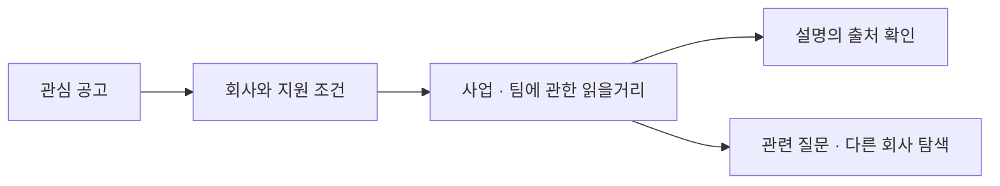
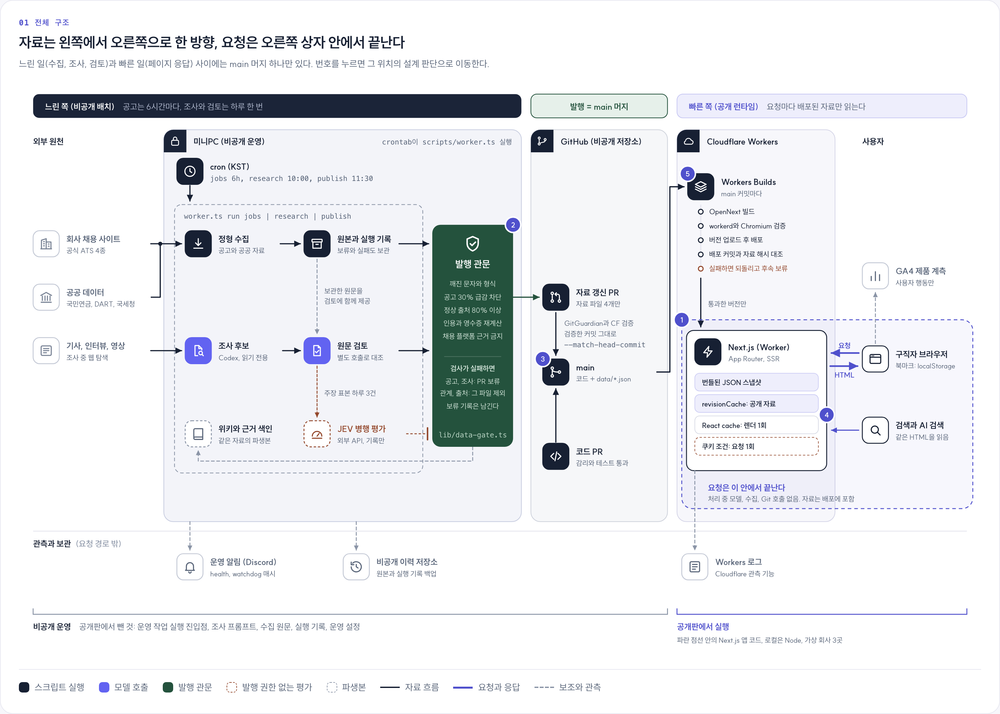

# Curvehop · Public Review Edition

[Curvehop](https://curvehop.net)'s web application, with fictional data for hiring review. No API keys required.

공고만 읽어서는 회사가 무엇을 만들고 어떻게 일하는지 알기 어렵습니다. [커브홉](https://curvehop.net)은 공고에서 회사 설명과 근거가 있는 읽을거리로 이동하며 지원할 회사를 알아보는 서비스입니다. 이 저장소에서는 운영 소스에서 가져온 웹 앱을 가상 데이터로 실행할 수 있습니다.

[운영 서비스](https://curvehop.net) · [5분 검토 동선](docs/review-guide.md) · [아키텍처](docs/architecture.md) · [설계 결정 3가지](docs/design-decisions.md)

## 무엇을 확인할 수 있나요?

공고의 기술 목록을 읽은 다음, “**이 회사는 무엇으로 돈을 벌고, 나는 어떤 팀에서 일하게 될까?**”를 이어서 확인하는 흐름입니다. 회사 설명과 읽을거리에는 출처를 연결하고, 확인된 사실과 답이 부족한 항목을 구분합니다.



검토자는 이 흐름을 로컬에서 실행하고, 아래 세 설계의 실패 사례를 테스트로 재현할 수 있습니다. 실제 회사 조사와 운영 자동화는 이 공개판의 실행 범위에 포함하지 않습니다.

## 전체 구조



운영 서비스에서는 미니PC가 정해진 시각에 수집·조사·검토를 끝내고, 발행 관문을 통과한 결과만 data PR로 main에 머지해 배포합니다. 페이지 요청은 배포된 자료만 읽으므로 처리 중에 모델·수집기·Git을 호출하지 않습니다. 이 저장소는 그림의 파란 점선 영역에 있는 Next.js 앱 코드를 가상 자료로 실행합니다. 운영은 Cloudflare Workers에서, 로컬은 Node에서 실행됩니다. 번호별 판단과 감수한 비용은 [아키텍처 문서](docs/architecture.md#운영-전체-구조)에 정리했습니다. 저장소를 클론한 뒤 `docs/architecture/architecture.html`을 브라우저로 열면 판단마다 구성도의 해당 위치를 강조해 볼 수 있습니다.

## 실행

Node.js 24를 권장합니다(최소 22). pnpm 버전은 10.28.2입니다.

```sh
pnpm install --frozen-lockfile
pnpm dev
```

[http://127.0.0.1:3100](http://127.0.0.1:3100)에서 공고 → 회사 → 읽을거리로 이동해 보세요. **가상 회사 3곳, 공고 15개, 읽을거리 12편**이 들어 있습니다. 데이터 기준일은 2026-10-22이며 실제 채용 정보가 아닙니다. API 키나 `.env` 설정은 필요하지 않습니다.

## 읽어 볼 설계

| 사용자에게 생길 문제 | 결정과 비용 | 확인할 코드·테스트 |
| --- | --- | --- |
| 다른 사람의 직무 조건이 내 목록에 섞인다 | 공개 자료만 공유하고 조건은 요청마다 조합한다. 파일 상태 확인 비용은 남긴다. | [자료 캐시](lib/published-data.ts) · [요청 분리 HTTP 테스트](tests/ssr-reads-http.test.mjs) |
| 자료가 갱신됐는데 느린 이전 요청이 옛 내용을 돌려준다 | 읽기 전후 revision을 확인한다. 계속 바뀌면 3회 후 오류를 반환한다. | [revision 캐시](lib/revision-cache.ts) · [경쟁 상태 테스트](tests/revision-cache.test.ts) |
| 근거보다 강한 설명이 모델 평가를 통과한다 | 근거·범위·인과를 따로 판정하고 불확실하면 보류한다. 평가에 발행 권한을 주지 않는다. | [JEV 계약](lib/jev-shadow.ts) · [경계값 테스트](tests/jev-shadow.test.ts) |

위 핵심 모듈은 기준 소스와 바이트가 같습니다. 각 결정의 이유와 검증 범위는 [설계 결정](docs/design-decisions.md)에서 이어집니다.

Next.js App Router, React, TypeScript를 사용합니다. 질문별 답변은 [질문 정의](lib/research-questions.ts) → [근거·범위 평가](lib/question-assessment.ts) → [화면 투영](lib/question-view.ts)으로 이어집니다. 저장된 자료가 있다는 것과 질문에 충분히 답한다는 것을 구분합니다.

## 검증

```sh
pnpm typecheck
pnpm test
pnpm test:sensitivity
pnpm build
pnpm test:http
pnpm verify:source
```

HTTP 검사는 production build를 사용하므로 `build`를 먼저 실행합니다. 검증 범위와 코드 동선은 [검토 가이드](docs/review-guide.md)에 정리했습니다.

## 이 공개판의 출처와 범위

기준 소스는 `d0e55193900a71f1f4d0fefdf714e20de849792a`입니다. 웹 런타임과 관련 계약을 가져오고, 데이터·실행 설정·일부 테스트를 공개 검토용으로 구성했습니다. [SOURCE_MANIFEST.json](SOURCE_MANIFEST.json)에 원본과 바이트가 같은 파일(`exact`), 공개판에서 변경한 파일(`adapter`), 생성한 파일(`generated`)을 구분하고 해시를 기록합니다. `pnpm verify:source`는 비공개 저장소 없이 공개 파일의 무결성을 확인합니다. 원본 저장소에 접근할 수 없는 검토자가 원본의 진위까지 독립적으로 확인하는 검사는 아닙니다.

공개 범위는 웹 화면, 탐색·필터·북마크, 자료 읽기와 검증, 질문 모델, JEV 계약과 모의 전송 테스트입니다. 웹 의존성을 유지하기 위한 수집 관련 유틸리티도 포함됩니다. **운영 worker와 조사·발행 실행 진입점, 조사 프롬프트, 실제 수집 원문·실행 기록, 원본의 전체 Git 이력은 제외**했습니다. [아키텍처 문서](docs/architecture.md)는 코드와 실행 범위의 경계를 설명합니다.

이 저장소의 이용 조건은 [LICENSE](LICENSE), 외부 자산 고지는 [THIRD_PARTY_NOTICES.md](THIRD_PARTY_NOTICES.md)를 확인하세요.
