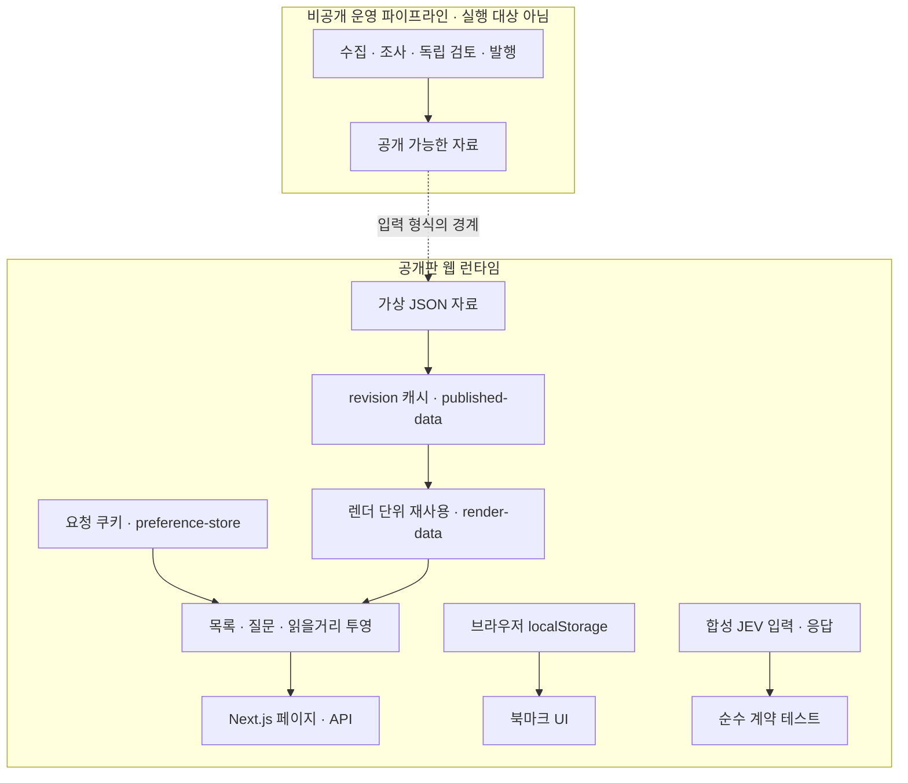

# 웹 런타임과 데이터 경계

**회사에 관한 자료는 함께 쓰되, 어떤 공고를 보여 줄지는 요청마다 결정합니다.** 같은 회사 페이지를 보는 두 사람도 관심 직무는 다를 수 있기 때문입니다. 느린 자료 수집이나 모델 호출을 페이지가 열릴 때마다 기다리게 하지 않는 것도 이 경계의 목적입니다.

공개판은 준비된 가상 자료를 읽어 화면으로 전달합니다. 운영 worker와 조사·발행 실행 진입점은 제외했습니다. 웹 코드가 참조하는 수집 관련 유틸리티 일부는 남아 있지만, 페이지 렌더가 조사를 실행하지는 않습니다.

점선은 공개판이 운영 데이터를 받는 연결이 아니라, 같은 데이터 형식을 사용하는 경계입니다. JEV 계약 테스트는 화면 렌더나 발행으로 이어지지 않습니다.

## 세 경계와 그 이유

| 경계 | 분리하는 이유 | 공개판에서 확인하는 방법 |
| --- | --- | --- |
| 조사·발행 ↔ 웹 조회 | 외부 수집의 실패가 방문자의 페이지 요청에 직접 전파되지 않게 한다. | 고정된 가상 자료만으로 앱을 실행한다. 운영 수집 자체는 제외했다. |
| 공개 자료 캐시 ↔ 요청 조건 | 같은 자료를 재사용하면서도 다른 사용자의 직무 조건이 섞이지 않게 한다. | 서로 다른 쿠키를 가진 동시 HTTP 요청을 검사한다. |
| 평가 결과 ↔ 발행 권한 | 모델의 높은 점수만으로 내용을 공개하지 않게 한다. | 합성 응답으로 임계값·오류·발행 권한 없음의 계약을 검사한다. 실제 모델 정확도 평가는 아니다. |

예를 들어 프론트엔드와 백엔드를 고른 두 요청은 같은 공고 스냅샷을 읽습니다. 각 요청이 쿠키와 URL 조건을 적용한 뒤 서로 다른 목록을 만듭니다. 그 사이 자료가 바뀌면 이전 읽기가 새 캐시를 덮어쓰지 못하도록 revision을 다시 확인합니다.

## 디렉터리를 나눈 기준

| 위치 | 책임 |
| --- | --- |
| `app/`, `components/` | 라우트, 서버 렌더, 화면과 상호작용 |
| `lib/` | 자료 읽기, 도메인 규칙, 화면 투영과 그 의존 모듈 |
| `data/` | 2026-10-22 기준 가상 스냅샷 |
| [`scripts/demo-data.ts`](../scripts/demo-data.ts) | 회사·공고·근거를 같은 필드 구조로 재생성 |
| `tests/` | 순수 계약과 임시 production 서버의 회귀 검사 |

원본 모듈 경로와 웹 의존 관계를 유지해 코드와 테스트를 대조할 수 있게 했습니다. 처음에는 아래 요청 흐름을 따라 읽고, 개별 모듈의 보존·변경 여부는 [SOURCE_MANIFEST.json](../SOURCE_MANIFEST.json)에서 확인하면 됩니다.

## 요청 한 번의 흐름

1. [`app/jobs/page.tsx`](../app/jobs/page.tsx)가 [`listJobs`](../lib/repository.ts)를 호출합니다. [`app/api/jobs/route.ts`](../app/api/jobs/route.ts)도 같은 목록 조합 함수를 사용합니다.
2. [`published-data.ts`](../lib/published-data.ts)는 파일 revision별로 읽기 결과를 공유합니다. [`render-data.ts`](../lib/render-data.ts)는 React `cache`로 한 서버 렌더 안의 중복 호출을 줄입니다.
3. [`preference-store.ts`](../lib/preference-store.ts)는 현재 요청의 쿠키를 읽습니다. [`preferences.ts`](../lib/preferences.ts)가 URL 조건과 저장한 선호를 조합합니다. 사용자 조건과 필터 결과는 공유 공개 자료 캐시에 넣지 않습니다.
4. [`repository.ts`](../lib/repository.ts)가 목록 노출 기준과 조건을 적용합니다. API는 `Cache-Control: no-store`를 반환합니다.

북마크는 [`components/bookmark.tsx`](../components/bookmark.tsx)의 브라우저 저장소를 사용합니다. 공개 자료 캐시와 북마크는 저장 위치와 수명이 다릅니다.

## 회사의 자료가 답변이 되는 흐름

[`research-questions.ts`](../lib/research-questions.ts)는 구직자의 질문과 세부 항목을 정의합니다. [`question-assessment.ts`](../lib/question-assessment.ts)는 근거·범위·상태의 계약을 다루고, [`question-view.ts`](../lib/question-view.ts)는 현재 자료와 정정을 반영한 화면 모델을 만듭니다.

회사 페이지는 이 모델을 [`question-presentation.ts`](../lib/question-presentation.ts)와 함께 사용합니다. 근거가 된 공고와 단순히 같은 회사에 속한 공고를 구분하고, 정정으로 무효화된 설명은 다시 확인해야 하는 상태로 전달합니다. 이는 **저장된 평가를 검증하고 표현하는 경로**입니다. 공개판 안에서 새로운 회사 조사를 수행하거나 발행을 승인하지 않습니다.

## 캐시가 보장하는 범위

캐시는 프로세스의 모듈 인스턴스에 속합니다. Proxy와 서버 렌더는 서로 다른 인스턴스를 가질 수 있습니다. 파일 상태와 읽기 전후 revision을 확인하며, 모든 호스트가 동시에 바뀌는 분산 트랜잭션을 제공하지 않습니다. 자세한 실패 경계는 [설계 결정](design-decisions.md)을 참고하세요.
