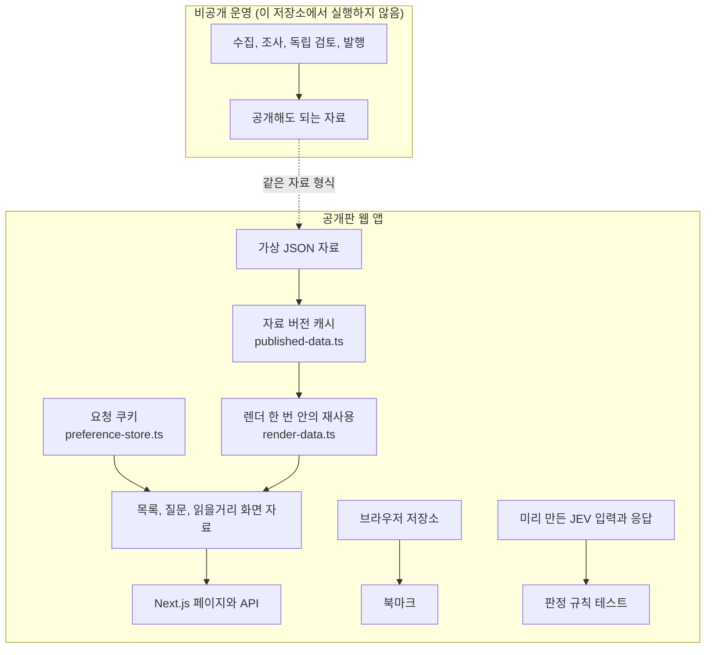
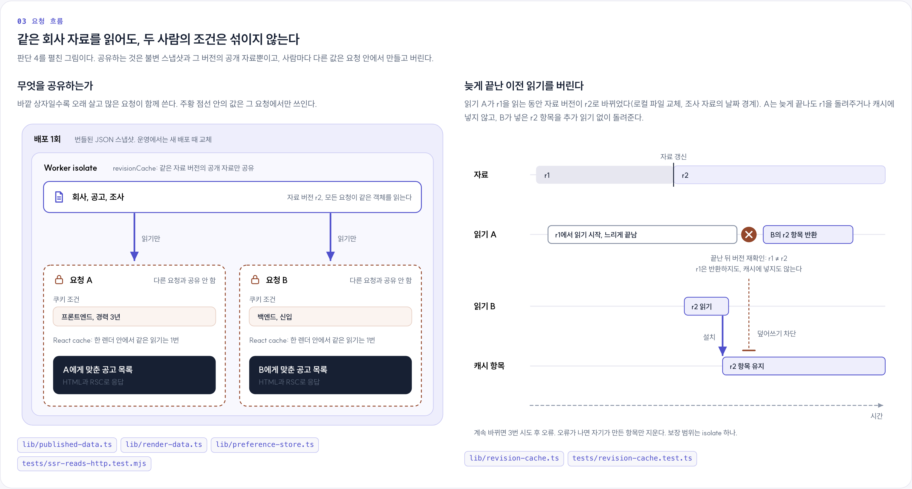

# 구조와 데이터 경계

회사에 관한 자료는 모두가 함께 쓰고, 어떤 공고를 보여 줄지는 요청마다 정합니다. 같은 회사 페이지를 보는 두 사람도 관심 직무는 다를 수 있기 때문입니다. 느린 자료 수집이나 모델 호출을 페이지가 열릴 때마다 기다리게 하지 않으려는 이유도 있습니다.

## 운영 전체 구조

자료는 왼쪽에서 오른쪽으로 한 방향으로만 흐르고, 요청은 오른쪽 점선 영역 안에서 끝납니다. 느린 일(수집, 조사, 검토)과 빠른 일(페이지 응답) 사이에는 main 머지 하나만 있습니다. 타일 색은 누가 결정하는지를 나타냅니다. 스크립트는 남색, 모델 호출은 보라, 발행 관문은 초록이고 발행 권한이 없는 평가는 주황 점선입니다.

1. 요청 경로에 모델과 수집을 두지 않습니다. 미니PC가 정해진 시각에 수집과 조사, 검토를 끝내 두고, 웹 앱은 배포에 포함된 JSON 파일만 읽습니다. 그 대가로 원문이 바뀌어도 다음 수집과 발행, 배포를 거쳐야 화면에 반영됩니다. 이 저장소의 [`lib/store.ts`](../lib/store.ts)와 [`ssr-reads-http.test.mjs`](../tests/ssr-reads-http.test.mjs), 비공개 운영 저장소의 `wrangler.jsonc`에서 확인할 수 있습니다.
2. 모델이 문제없이 끝났다고 해서 발행을 승인하지 않습니다. 조사 후보 작성과 원문 검토를 서로 다른 호출로 나누고, 공개 여부는 스크립트가 형식과 인용, 반영 영수증을 다시 계산해 정합니다. 공고나 회사 조사 검사가 실패하면 자료 갱신 PR 전체를 보류하고, 회사 관계와 출처 등록 파일은 그 파일만 뺍니다. 외부 평가 모델 JEV는 판정을 기록할 뿐 발행을 정하지 않습니다. 호출과 지연이 늘고, 근거가 부족한 주제는 보류로 남습니다. 이 저장소의 [`jev-shadow.ts`](../lib/jev-shadow.ts)와 [`jev-shadow.test.ts`](../tests/jev-shadow.test.ts), 운영 저장소의 `lib/data-gate.ts`와 `lib/research-publication.ts`에 있습니다.
3. 데이터베이스 대신 Git에 둔 JSON 파일을 씁니다. 자료와 코드를 같은 커밋으로 비교하고 되돌리며, 배포된 내용을 확인합니다. 미니PC가 자동으로 머지할 수 있는 파일은 공고, 회사 조사, 회사 관계, 등록 출처 4개뿐입니다. 자료 갱신 PR은 검증한 커밋 그대로만 머지하고, 나머지 자료 파일은 코드 PR로만 바뀝니다. 자료가 늘면 번들과 빌드가 커지고, 자동 쓰기는 미니PC 한 곳에서만 합니다. 운영 저장소의 `lib/deployment-data.ts`와 `lib/worker.ts`에 있습니다.
4. 공유 캐시에는 공개 자료만 넣습니다. 사람마다 다른 조건은 요청 안에서 조합합니다. 아래 [요청 한 번의 흐름](#요청-한-번의-흐름)과 [설계 결정](design-decisions.md)의 1, 2번에서 이어집니다.
5. 배포가 성공했는지는 실서비스가 그 커밋을 내보내는지로 판정합니다. 로컬 Workers 런타임(workerd)과 Chromium으로 검증한 뒤 올리고, 실서비스가 알려 주는 커밋과 자료 해시를 기대값과 대조합니다. 맞지 않으면 이전 버전으로 되돌리고 다음 배포를 보류합니다. 운영 저장소의 `scripts/cloudflare-builds.mjs`와 `app/api/release/route.ts`에 있습니다.

그림과 위 목록은 2026년 10월 22일 오후의 운영 코드를 기준으로 그렸습니다. 이 저장소의 코드는 같은 날 오전 시점입니다. 그 사이에는 회사 홈페이지 신원 확인과 데이터, 문서만 바뀌었고 그림의 구조와 경계는 같습니다. 스케줄과 머지 조건 같은 운영 절차는 이 저장소에서 실행되지 않습니다. 이 저장소가 실행하는 것은 파란 점선 영역의 Next.js 앱 코드이고, 운영의 Cloudflare Workers 대신 로컬 Node에서 돌아갑니다. 그림의 원본은 [`architecture/build.mjs`](architecture/build.mjs)이고 이미지는 [`capture.mjs`](architecture/capture.mjs)로 만듭니다.

## 공개판이 실행하는 범위

공개판은 미리 만든 가상 자료를 읽어 화면에 보여 줍니다. 미니PC 운영 작업 코드와 조사, 발행을 실행하는 진입점은 넣지 않았습니다. 웹 코드가 참조하는 수집용 보조 코드는 일부 남아 있지만, 페이지를 그리는 동안 조사를 실행하지는 않습니다.

점선은 공개판이 운영 자료를 받아 온다는 뜻이 아닙니다. 두 쪽이 같은 자료 형식을 쓴다는 경계입니다. JEV 판정 규칙 테스트는 화면이나 발행으로 이어지지 않습니다.

## 세 경계와 그 이유

| 나눈 것 | 나눈 이유 | 공개판에서 확인하는 방법 |
| --- | --- | --- |
| 조사와 발행을 웹 조회에서 분리 | 외부 수집이 실패해도 방문자의 페이지 요청까지 번지지 않게 한다. | 고정된 가상 자료만으로 앱을 실행한다. 운영 수집은 들어 있지 않다. |
| 공개 자료 캐시를 요청 조건에서 분리 | 같은 자료를 재사용하면서도 다른 사람의 직무 조건이 섞이지 않게 한다. | 쿠키가 서로 다른 HTTP 요청을 동시에 보내 검사한다. |
| 평가 결과를 발행 권한에서 분리 | 모델 점수가 높다는 이유만으로 내용을 공개하지 않게 한다. | 미리 만든 응답으로 임계값과 오류 처리, 발행 권한이 없다는 점을 검사한다. 실제 모델 정확도를 평가하지는 않는다. |

예를 들어 프론트엔드와 백엔드를 고른 두 요청은 같은 공고 스냅샷을 읽습니다. 각 요청이 쿠키와 URL 조건을 적용해 서로 다른 목록을 만듭니다. 그 사이 자료가 바뀌면 이전 읽기가 새 캐시를 덮어쓰지 못하도록 자료 버전을 다시 확인합니다.

## 디렉터리를 나눈 기준

| 위치 | 맡은 일 |
| --- | --- |
| `app/`, `components/` | 라우트, 서버 렌더, 화면과 상호작용 |
| `lib/` | 자료 읽기, 도메인 규칙, 화면에 맞게 자료를 바꾸는 코드와 그 의존 모듈 |
| `data/` | 2026-10-22 기준 가상 스냅샷 |
| [`scripts/demo-data.ts`](../scripts/demo-data.ts) | 회사, 공고, 근거를 같은 필드 구조로 다시 생성 |
| `tests/` | 순수 함수 검사와, 임시로 띄운 운영용 빌드 서버의 회귀 검사 |

모듈 경로와 웹 의존 관계는 운영 코드와 같게 두어 코드와 테스트를 서로 대조할 수 있게 했습니다. 처음에는 아래 요청 흐름을 따라 읽으면 됩니다. 모듈마다 원본 그대로인지 바뀌었는지는 [SOURCE_MANIFEST.json](../SOURCE_MANIFEST.json)에서 확인할 수 있습니다.

## 요청 한 번의 흐름

1. [`app/jobs/page.tsx`](../app/jobs/page.tsx)가 [`listJobs`](../lib/repository.ts)를 호출합니다. [`app/api/jobs/route.ts`](../app/api/jobs/route.ts)도 같은 목록 함수를 씁니다.
2. [`published-data.ts`](../lib/published-data.ts)는 파일의 자료 버전별로 읽은 결과를 공유합니다. [`render-data.ts`](../lib/render-data.ts)는 React `cache`로 서버 렌더 한 번 안의 중복 호출을 줄입니다.
3. [`preference-store.ts`](../lib/preference-store.ts)가 현재 요청의 쿠키를 읽고, [`preferences.ts`](../lib/preferences.ts)가 URL 조건과 저장한 선호를 합칩니다. 사용자 조건과 필터 결과는 공유 캐시에 넣지 않습니다.
4. [`repository.ts`](../lib/repository.ts)가 목록 노출 기준과 조건을 적용합니다. API는 `Cache-Control: no-store`로 응답합니다.

북마크는 [`components/bookmark.tsx`](../components/bookmark.tsx)에서 브라우저 저장소에 둡니다. 공개 자료 캐시와 북마크는 저장 위치도 수명도 다릅니다.

## 회사의 자료가 답변이 되는 흐름

[`research-questions.ts`](../lib/research-questions.ts)는 구직자의 질문과 세부 항목을 정의합니다. [`question-assessment.ts`](../lib/question-assessment.ts)는 근거와 범위, 답변 상태를 판정하는 규칙을 다루고, [`question-view.ts`](../lib/question-view.ts)는 현재 자료와 정정을 반영해 화면에 보여 줄 형태로 만듭니다.

회사 페이지는 이 결과를 [`question-presentation.ts`](../lib/question-presentation.ts)와 함께 씁니다. 근거가 된 공고와 단지 같은 회사에 속한 공고를 구분하고, 정정으로 무효가 된 설명은 다시 확인이 필요한 상태로 넘깁니다. 이 경로는 저장된 평가를 검증하고 보여 주는 일까지만 합니다. 공개판 안에서 새 회사를 조사하거나 발행을 승인하지 않습니다.

## 캐시가 보장하는 범위

캐시는 프로세스의 모듈 인스턴스에 속합니다. 프록시(`proxy.ts`)와 서버 렌더는 서로 다른 인스턴스를 가질 수 있습니다. 파일 상태와 읽기 전후의 자료 버전은 확인하지만, 모든 호스트가 동시에 바뀌는 분산 트랜잭션은 제공하지 않습니다. 자세한 실패 경계는 [설계 결정](design-decisions.md)을 참고하세요.
