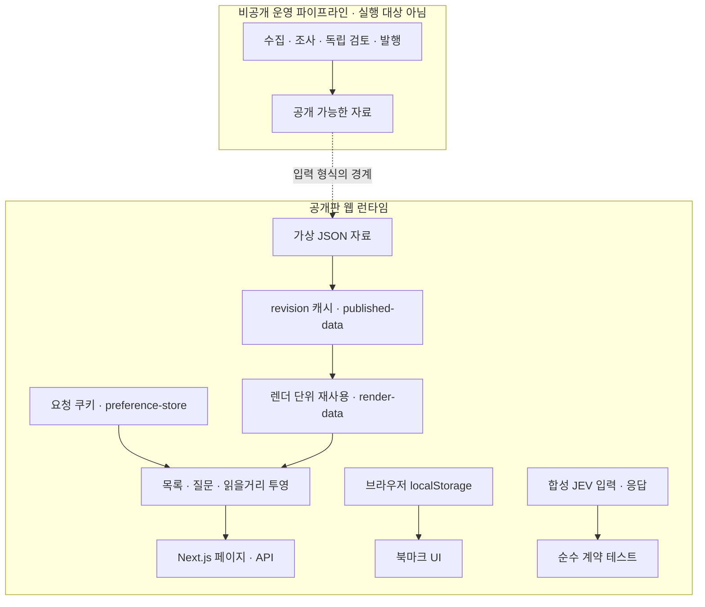

# 웹 런타임과 데이터 경계

**회사에 관한 자료는 함께 쓰되, 어떤 공고를 보여 줄지는 요청마다 결정합니다.** 같은 회사 페이지를 보는 두 사람도 관심 직무는 다를 수 있기 때문입니다. 느린 자료 수집이나 모델 호출을 페이지가 열릴 때마다 기다리게 하지 않는 것도 이 경계의 목적입니다.

## 운영 전체 구조

자료는 왼쪽에서 오른쪽으로 한 방향으로 흐르고, 요청은 오른쪽 점선 영역 안에서 끝납니다. 느린 일(수집·조사·검토)과 빠른 일(페이지 응답) 사이에는 main 머지 하나만 있습니다. 타일 색은 결정 주체를 나타냅니다. 스크립트는 남색, 모델 호출은 보라, 발행 관문은 초록입니다. 발행 권한이 없는 평가는 주황 점선으로 표시했습니다.

1. **요청 경로에 모델과 수집을 두지 않습니다.** 미니PC가 정해진 시각에 수집·조사·검토를 끝내 두고, Worker는 배포에 포함된 JSON만 읽습니다. 그 대가로 원문이 바뀌어도 다음 수집·발행·배포를 거쳐야 화면에 반영됩니다. 이 저장소: [`lib/store.ts`](../lib/store.ts), [`ssr-reads-http.test.mjs`](../tests/ssr-reads-http.test.mjs) · 운영 저장소: `wrangler.jsonc`
2. **모델의 정상 종료를 발행 승인으로 보지 않습니다.** 조사 후보와 원문 검토를 별도 호출로 나누고, 공개 여부는 스크립트가 형식·인용·반영 영수증을 다시 계산해 정합니다. 공고·리서치 검사가 실패하면 data PR 전체를 보류하고, 관계·등록 출처는 그 파일만 뺍니다. JEV는 판정만 기록합니다. 호출과 지연이 늘고, 근거가 부족한 주제는 보류로 남습니다. 이 저장소: [`jev-shadow.ts`](../lib/jev-shadow.ts), [`jev-shadow.test.ts`](../tests/jev-shadow.test.ts) · 운영 저장소: `lib/data-gate.ts`, `lib/research-publication.ts`
3. **데이터베이스 대신 Git의 JSON 파일을 씁니다.** 자료와 코드를 같은 커밋으로 비교하고 되돌리며 배포 내용을 확인합니다. 미니PC가 자동 머지할 수 있는 파일은 공고·리서치·관계·등록 출처 4개뿐이고, data PR은 검증한 head 그대로만 머지합니다. 나머지 data JSON은 코드 PR로만 바뀝니다. 자료가 늘면 번들과 빌드가 커지고, 자동 쓰기는 미니PC 한 곳에서만 합니다. 운영 저장소: `lib/deployment-data.ts`, `lib/worker.ts`
4. **공유 캐시에는 공개 자료만 넣습니다.** 사람마다 다른 조건은 요청 안에서 조합합니다. 아래 [요청 한 번의 흐름](#요청-한-번의-흐름)과 [설계 결정 1·2](design-decisions.md)에서 이어집니다.
5. **배포 성공은 실서비스가 그 커밋을 내보내는지로 판정합니다.** workerd·Chromium 검증 뒤 업로드하고, 실서비스의 git SHA·자료 해시를 기대값과 대조합니다. 실패하면 rollback하고 다음 배포를 보류합니다. 운영 저장소: `scripts/cloudflare-builds.mjs`, `app/api/release/route.ts`

그림과 위 목록은 운영 소스 `ecbbdf8`(2026-10-22) 기준입니다. 이 공개판의 고정 소스 `d0e5519` 이후 바뀐 것은 회사 홈페이지 신원 확인과 데이터·문서이며, 그림의 구조와 경계는 같습니다. 스케줄과 머지 조건 같은 운영 절차는 이 저장소에서 실행되지 않습니다. 이 저장소가 실행하는 것은 파란 점선 영역의 Next.js 앱 코드이며, 운영의 Cloudflare Workers 대신 로컬 Node에서 동작합니다. 그림의 원본은 [`architecture/build.mjs`](architecture/build.mjs)이고, [`capture.mjs`](architecture/capture.mjs)로 이미지를 만듭니다.

## 공개판이 실행하는 범위

공개판은 준비된 가상 자료를 읽어 화면으로 전달합니다. 운영 worker와 조사·발행 실행 진입점은 제외했습니다. 웹 코드가 참조하는 수집 관련 유틸리티 일부는 남아 있지만, 페이지 렌더가 조사를 실행하지는 않습니다.

점선은 공개판이 운영 데이터를 받는 연결이 아니라, 같은 데이터 형식을 사용하는 경계입니다. JEV 계약 테스트는 화면 렌더나 발행으로 이어지지 않습니다.

## 세 경계와 그 이유

| 경계 | 분리하는 이유 | 공개판에서 확인하는 방법 |
| --- | --- | --- |
| 조사·발행 ↔ 웹 조회 | 외부 수집의 실패가 방문자의 페이지 요청에 직접 전파되지 않게 한다. | 고정된 가상 자료만으로 앱을 실행한다. 운영 수집 자체는 제외했다. |
| 공개 자료 캐시 ↔ 요청 조건 | 같은 자료를 재사용하면서도 다른 사용자의 직무 조건이 섞이지 않게 한다. | 서로 다른 쿠키를 가진 동시 HTTP 요청을 검사한다. |
| 평가 결과 ↔ 발행 권한 | 모델의 높은 점수만으로 내용을 공개하지 않게 한다. | 합성 응답으로 임계값·오류·발행 권한 없음의 계약을 검사한다. 실제 모델 정확도 평가는 아니다. |

예를 들어 프론트엔드와 백엔드를 고른 두 요청은 같은 공고 스냅샷을 읽습니다. 각 요청이 쿠키와 URL 조건을 적용한 뒤 서로 다른 목록을 만듭니다. 그 사이 자료가 바뀌면 이전 읽기가 새 캐시를 덮어쓰지 못하도록 revision을 다시 확인합니다.

## 디렉터리를 나눈 기준

| 위치 | 책임 |
| --- | --- |
| `app/`, `components/` | 라우트, 서버 렌더, 화면과 상호작용 |
| `lib/` | 자료 읽기, 도메인 규칙, 화면 투영과 그 의존 모듈 |
| `data/` | 2026-10-22 기준 가상 스냅샷 |
| [`scripts/demo-data.ts`](../scripts/demo-data.ts) | 회사·공고·근거를 같은 필드 구조로 재생성 |
| `tests/` | 순수 계약과 임시 production 서버의 회귀 검사 |

원본 모듈 경로와 웹 의존 관계를 유지해 코드와 테스트를 대조할 수 있게 했습니다. 처음에는 아래 요청 흐름을 따라 읽고, 개별 모듈의 보존·변경 여부는 [SOURCE_MANIFEST.json](../SOURCE_MANIFEST.json)에서 확인하면 됩니다.

## 요청 한 번의 흐름

1. [`app/jobs/page.tsx`](../app/jobs/page.tsx)가 [`listJobs`](../lib/repository.ts)를 호출합니다. [`app/api/jobs/route.ts`](../app/api/jobs/route.ts)도 같은 목록 조합 함수를 사용합니다.
2. [`published-data.ts`](../lib/published-data.ts)는 파일 revision별로 읽기 결과를 공유합니다. [`render-data.ts`](../lib/render-data.ts)는 React `cache`로 한 서버 렌더 안의 중복 호출을 줄입니다.
3. [`preference-store.ts`](../lib/preference-store.ts)는 현재 요청의 쿠키를 읽습니다. [`preferences.ts`](../lib/preferences.ts)가 URL 조건과 저장한 선호를 조합합니다. 사용자 조건과 필터 결과는 공유 공개 자료 캐시에 넣지 않습니다.
4. [`repository.ts`](../lib/repository.ts)가 목록 노출 기준과 조건을 적용합니다. API는 `Cache-Control: no-store`를 반환합니다.

북마크는 [`components/bookmark.tsx`](../components/bookmark.tsx)의 브라우저 저장소를 사용합니다. 공개 자료 캐시와 북마크는 저장 위치와 수명이 다릅니다.

## 회사의 자료가 답변이 되는 흐름

[`research-questions.ts`](../lib/research-questions.ts)는 구직자의 질문과 세부 항목을 정의합니다. [`question-assessment.ts`](../lib/question-assessment.ts)는 근거·범위·상태의 계약을 다루고, [`question-view.ts`](../lib/question-view.ts)는 현재 자료와 정정을 반영한 화면 모델을 만듭니다.

회사 페이지는 이 모델을 [`question-presentation.ts`](../lib/question-presentation.ts)와 함께 사용합니다. 근거가 된 공고와 단순히 같은 회사에 속한 공고를 구분하고, 정정으로 무효화된 설명은 다시 확인해야 하는 상태로 전달합니다. 이는 **저장된 평가를 검증하고 표현하는 경로**입니다. 공개판 안에서 새로운 회사 조사를 수행하거나 발행을 승인하지 않습니다.

## 캐시가 보장하는 범위

캐시는 프로세스의 모듈 인스턴스에 속합니다. Proxy와 서버 렌더는 서로 다른 인스턴스를 가질 수 있습니다. 파일 상태와 읽기 전후 revision을 확인하며, 모든 호스트가 동시에 바뀌는 분산 트랜잭션을 제공하지 않습니다. 자세한 실패 경계는 [설계 결정](design-decisions.md)을 참고하세요.
